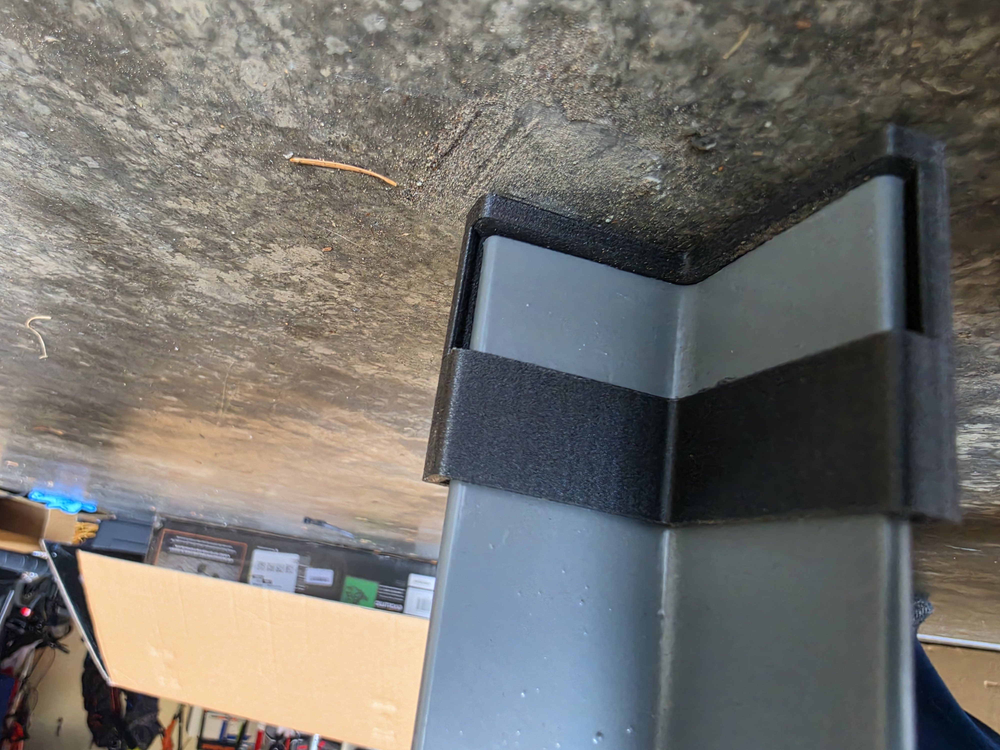
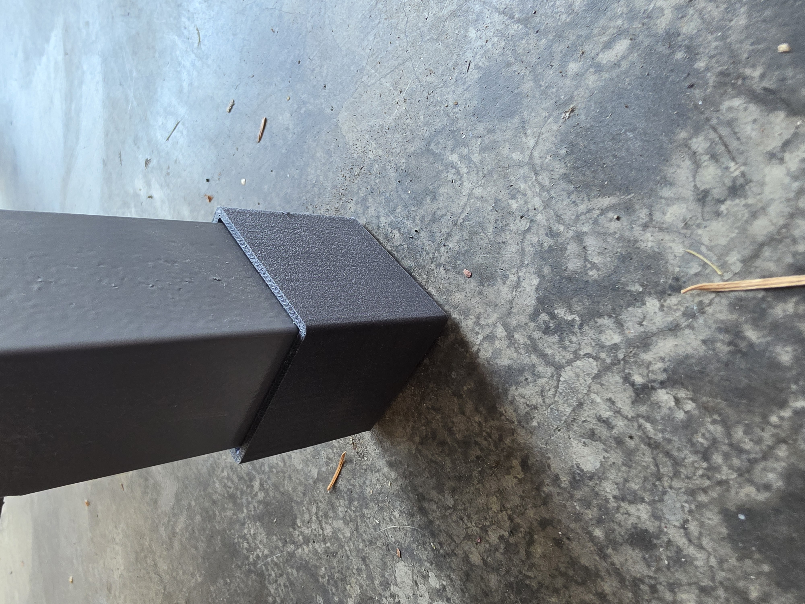

## Overview

The Little Giant table I bought would rock on my uneven garage floor, and using metal spacers would lead to metal-on-metal contact which could slip easily. I designed 3D-Printable "socks" that could slide onto the L-shaped table legs easily to level the table.

## In action

<video autoplay loop muted playsinline preload="metadata" poster="/videos/table-leveling-socks-poster.jpg" class="mx-auto w-full max-w-xl rounded-xl border border-zinc-200 dark:border-zinc-800" aria-label="CAD animation of the sock and leveling spacer assembling onto the table leg">
  <source src="/videos/table-leveling-socks.mp4" type="video/mp4" />
</video>

## How it works

The sock needs to reduce friction and also add easy leveling access. To reduce friction a small TPU insert was added for better grip. The insert was printed at 100% infill to reduce compression. An opening was created in the side of the sock so that L-shaped inserts can be added to level different legs of the table easily.

## Design and prototyping

- **Material:** Plastic sock printed in PETG-CF, rubber insert printed in TPU 95A
- **Fit:** Specifically designed to fit on the Little Giant MT1
- **Iterations:** No problems found yet, if something changes will update with a new iteration.

## Testing

Without any socks table was rocking ~1/8", after adding socks on all four tables and adding 1/8" spacers to two legs there was no rocking. There has not been continuous load testing yet but the spacers and socks should hold up due to being printed on a high infill.

## Status and next steps

- TODO: Update after continued testing under load
